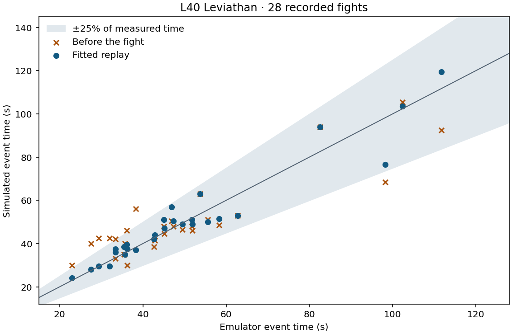
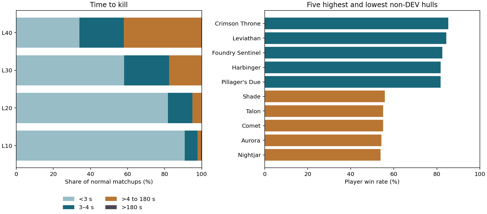

# Balance calibration against emulator runs 112 and 113

The stock guardian level explains why the old simulator made flagship hulls much harder to kill while making their guns much more lethal. Correcting that mechanic and fitting three shared exposure parameters reproduces all 28 measured Leviathan event clocks within 25%. Before the simulator sees any geometry or opening damage from the fight, that falls to 20/28. Use the latter figure to judge a prediction for a new encounter.

The model evaluates the requested starting branch at `a02248ca`. The emulator evidence comes from the supplied historical runs. The Python baseline and oracle inputs come from `90acce6a` on `codex/task-2-balance-sim`. The half-second combat loop, stock-rack extraction, updated roster, calibration and matchup tables are local to this analysis.

<!-- BEGIN GENERATED RESULTS -->

### Can the simulator reproduce the emulator clocks?

| Method | Within 25% | Median absolute error | Largest absolute error | Correct duel outcome |
| --- | --- | --- | --- | --- |
| Legacy | 0/28 | 83.86% | 541.93% | — |
| Corrected, before fit | 25/28 | 11.24% | 49.69% | — |
| Fitted replay | 28/28 | 6.85% | 22.11% | 27/28 |
| Leave-one-out replay | 27/28 | 7.41% | 33.82% | 27/28 |
| Leave-one-out before fight | 20/28 | 12.99% | 46.44% | 27/28 |

The fitted replay meets both clock targets. The prediction available before launch misses eight fights. Ironclad illustrates why the two scores differ. The emulator Leviathan killed it in 82.510 s. The held-out replay gives a 94 s kill clock and a 72 s death clock, so it predicts a loss. [Recorded fight, lines 147–231](../../batch2/data/dmgtest/dmg-d1.txt#L147)



### All 28 Leviathan fights

| Run | Faction | Event | Measured s | Fitted s | Error | Held-out replay s | Before fight s | Error |
| --- | --- | --- | --- | --- | --- | --- | --- | --- |
| [112 flagship](../../batch2/data/dmgtest/dmg-d1.txt#L41) | spartan | death | 38.24 | 37.0 | -3.2% | 37.0 | 56.0 | +46.4% |
| [112 flagship](../../batch2/data/dmgtest/dmg-d1.txt#L146) | reaver | kill | 102.36 | 103.5 | +1.1% | 123.0 | 105.5 | +3.1% |
| [112 flagship](../../batch2/data/dmgtest/dmg-d1.txt#L231) | ironclad | kill | 82.51 | 94.0 | +13.9% | 94.0 | 94.0 | +13.9% |
| [112 flagship](../../batch2/data/dmgtest/dmg-d1.txt#L297) | kretari | kill | 62.78 | 53.0 | -15.6% | 53.0 | 53.0 | -15.6% |
| [112 flagship](../../batch2/data/dmgtest/dmg-d1.txt#L398) | helion | kill | 98.22 | 76.5 | -22.1% | 65.0 | 68.5 | -30.3% |
| [112 flagship](../../batch2/data/dmgtest/dmg-d1.txt#L512) | warden | death | 111.69 | 119.5 | +7.0% | 119.5 | 92.5 | -17.2% |
| [112 flagship](../../batch2/data/dmgtest/dmg-d1.txt#L569) | varn | kill | 53.71 | 63.0 | +17.3% | 63.0 | 63.0 | +17.3% |
| [112 police](../../batch2/data/dmgtest/dmg-d2.txt#L54) | spartan | death | 51.88 | 49.0 | -5.6% | 49.0 | 46.0 | -11.3% |
| [112 police](../../batch2/data/dmgtest/dmg-d2.txt#L115) | reaver | death | 58.29 | 51.5 | -11.7% | 51.5 | 48.5 | -16.8% |
| [112 police](../../batch2/data/dmgtest/dmg-d2.txt#L154) | ironclad | death | 36.19 | 37.5 | +3.6% | 37.5 | 30.0 | -17.1% |
| [112 police](../../batch2/data/dmgtest/dmg-d2.txt#L202) | kretari | death | 45.15 | 47.0 | +4.1% | 47.0 | 44.5 | -1.4% |
| [112 police](../../batch2/data/dmgtest/dmg-d2.txt#L248) | helion | death | 42.67 | 42.0 | -1.6% | 42.0 | 38.5 | -9.8% |
| [112 police](../../batch2/data/dmgtest/dmg-d2.txt#L284) | warden | death | 33.39 | 37.5 | +12.3% | 37.5 | 33.0 | -1.2% |
| [112 police](../../batch2/data/dmgtest/dmg-d2.txt#L330) | varn | death | 42.88 | 44.0 | +2.6% | 44.0 | 41.5 | -3.2% |
| [113 still](../../batch2/data/dmgtest/round2-dmg-d2.txt#L54) | spartan | death | 51.75 | 51.0 | -1.4% | 51.0 | 48.0 | -7.2% |
| [113 still](../../batch2/data/dmgtest/round2-dmg-d2.txt#L104) | reaver | death | 46.85 | 57.0 | +21.6% | 57.0 | 50.5 | +7.8% |
| [113 still](../../batch2/data/dmgtest/round2-dmg-d2.txt#L130) | ironclad | death | 22.98 | 24.0 | +4.4% | 24.0 | 30.0 | +30.5% |
| [113 still](../../batch2/data/dmgtest/round2-dmg-d2.txt#L182) | kretari | death | 49.55 | 49.0 | -1.1% | 49.0 | 46.5 | -6.2% |
| [113 still](../../batch2/data/dmgtest/round2-dmg-d2.txt#L221) | helion | death | 35.70 | 35.0 | -1.9% | 35.0 | 40.0 | +12.1% |
| [113 still](../../batch2/data/dmgtest/round2-dmg-d2.txt#L259) | warden | death | 35.47 | 38.5 | +8.6% | 38.5 | 35.0 | -1.3% |
| [113 still](../../batch2/data/dmgtest/round2-dmg-d2.txt#L291) | varn | death | 29.39 | 29.5 | +0.4% | 29.5 | 42.5 | +44.6% |
| [113 dodge D4](../../batch2/data/dmgtest/round2-dmg-d4.txt#L48) | spartan | death | 45.03 | 51.0 | +13.2% | 51.0 | 48.0 | +6.6% |
| [113 dodge D4](../../batch2/data/dmgtest/round2-dmg-d4.txt#L106) | reaver | death | 55.55 | 50.0 | -10.0% | 50.0 | 51.0 | -8.2% |
| [113 dodge D4](../../batch2/data/dmgtest/round2-dmg-d4.txt#L156) | ironclad | death | 47.32 | 50.5 | +6.7% | 50.5 | 48.0 | +1.4% |
| [113 dodge D4](../../batch2/data/dmgtest/round2-dmg-d4.txt#L195) | kretari | death | 36.16 | 39.5 | +9.2% | 39.5 | 46.0 | +27.2% |
| [113 dodge D5](../../batch2/data/dmgtest/round2-dmg-d5.txt#L31) | helion | death | 27.56 | 28.0 | +1.6% | 28.0 | 40.0 | +45.1% |
| [113 dodge D5](../../batch2/data/dmgtest/round2-dmg-d5.txt#L67) | warden | death | 33.37 | 36.0 | +7.9% | 36.0 | 42.0 | +25.9% |
| [113 dodge D5](../../batch2/data/dmgtest/round2-dmg-d5.txt#L102) | varn | death | 32.01 | 29.5 | -7.8% | 29.5 | 42.5 | +32.8% |

### Where predictive errors remain

SUSPECTED — The held-out Helion flagship replay gives 65.0 s against 98.220 s (−33.82%). Its logged centre range was 1,319–2,802 units. This single trace gives distance but omits turret orientation, impact position and missed rails. A scalar range/landed fraction cannot identify which volleys connected. [Helion log](../../batch2/data/dmgtest/dmg-d1.txt#L298)

SUSPECTED — The other seven pre-fight misses are late death predictions. The opening estimates for these seven runs are four or five drones. Drawing 2–5 per launch before the fight includes smaller wings. Early overlapping rail bursts, skill contact, relative bearing and wall interception can produce similar hull losses. No per-hit attribution or directly observed wing counts distinguish them. The rows above give the signed gap for each run. [D1](../../batch2/data/dmgtest/dmg-d1.txt#L1) · [D2](../../batch2/data/dmgtest/round2-dmg-d2.txt#L105) · [D4](../../batch2/data/dmgtest/round2-dmg-d4.txt#L157) · [D5](../../batch2/data/dmgtest/round2-dmg-d5.txt#L1)

The Warlord was held out of fitting. Of nine timed deaths, 6/9 replays and 3/9 pre-fight predictions fall within 25%. Median errors are 19.49% and 31.56%. The Reaver run was censored at 180.017 s. Both replay clocks exceed 180 s. Its pre-fight timeout frequency is 100.0%. [All ten Warlord rows and outcomes](comparisons.csv)

### How often do ordinary enemies die in 3–4 seconds?

| Level | Normal rows | Median TTK | Under 3 s | 3–4 s | Over 4 s¹ | Favorable median | Favorable 3–4 s |
| --- | --- | --- | --- | --- | --- | --- | --- |
| 10 | 12320 | 1.5 s | 90.8% | 7.0% | 2.2% | 1.5 s | 0.0% |
| 20 | 13552 | 2 s | 81.8% | 13.2% | 5.0% | 1 s | 0.0% |
| 30 | 17864 | 2.5 s | 58.1% | 24.3% | 17.5% | 1 s | 2.1% |
| 40 | 20328 | 3.5 s | 34.1% | 23.9% | 42.0% | 2 s | 20.4% |

¹ Includes right-censored rows. Across all 64,064 normal rows, 18.5% land in the target band. At L40 the median is in the band, but this alone masks the spread. Favorable means the hull faction counters the enemy faction. CONFIRMED — Ordinary-enemy damage gains a 2.5× factor with advantage and 0.5× with disadvantage. The source describes approximate favorable/neutral/unfavorable targets of 3/10/25 seconds. [ModV35.java:773,837](../../../src/java/fr/testudo/spacecorsair/mod/ModV35.java#L773)

### Can 3× threaten an L40 player?

Yes. In the stock-shield rail harness, two of seven faction flagships killed the L40 Leviathan and all seven police variants killed it. With a legal high-DPS loadout, a full shield, missiles and manual doomsday, the model gives the following paired results for the same max-refit Leviathan. Each cell covers seven opponents and 7,000 fights. Only battery damage and its inherited drone rail damage change in the 1× counterfactual. Skill fractions and police bonuses stay fixed. [Run 112](../../batch2/data/dmgtest/RESULTS.md#L6) · [Paired runs](threat.csv)

| Opponent | Battery multiplier | Player wins | Player deaths | Ties / timeouts |
| --- | --- | --- | --- | --- |
| Faction flagship | 1× | 98.8% | 1.1% | 1/0 |
| Faction flagship | 3× | 96.3% | 3.7% | 0/0 |
| Police | 1× | 76.6% | 22.1% | 33/59 |
| Police | 3× | 21.1% | 78.4% | 35/0 |

At 3×, the full L40 grid across all hulls and refits gives these rates. These are matchup-weighted scenario estimates. The emulator tested two player hulls.

| L40 opponent | Player wins | Player deaths |
| --- | --- | --- |
| faction flagship/titan | 49.8% | 47.5% |
| police titan | 2.5% | 97.4% |

### Why do police titans kill the Leviathan in 33–58 seconds?

| Setup | Seven observed deaths | Fitted deaths | Before-fight death clocks | Predicted deaths |
| --- | --- | --- | --- | --- |
| 112 stock still | 33.388–58.293 s | 37.5–51.5 s | 30–48.5 s | 7/7 |
| 113 best still | 22.981–51.747 s | 24–57 s | 30–50.5 s | 7/7 |
| 113 best dodge | 27.56–55.546 s | 28–51 s | 40–51 s | 7/7 |

CONFIRMED — The capped guardian battery is weak against L40 after stock level mitigation. The police drones launch at L40 and avoid that penalty. One police rail is about 7,597 damage at equal pilot level before interception. A 2–5 drone wing therefore offers roughly 6,900–17,300 damage/s before misses and the wall. Against 446,656 hull, that is a 26–65 s hull-only scale. Skill damage, shield break, regeneration and the wall move the result within or outside that range. The police overshield helps the titan stay alive long enough to deal it. [Source audit below](#source-audit) · [Run 112](../../batch2/data/dmgtest/dmg-d2.txt#L1)

### The five highest and lowest combat win rates

| Highest non-DEV hull | Win rate | Lowest non-DEV hull | Win rate |
| --- | --- | --- | --- |
| Crimson Throne | 85.39% | Nightjar | 53.84% |
| Leviathan | 84.44% | Aurora | 54.25% |
| Foundry Sentinel | 82.59% | Comet | 55.01% |
| Harbinger | 81.76% | Talon | 55.09% |
| Pillager's Due | 81.76% | Shade | 55.79% |

Each legal hull/refit/level/opponent row has equal weight. Higher levels have more opponents. Industrial and original hulls participate. This ranking measures combat strength under the loadout policy, without price, unlock or cargo utility. The DEV hull scores 89.73% and appears separately in the complete CSV. [All 56 hulls](hull-ranking.csv)



<!-- END GENERATED RESULTS -->

## What the harness actually measured

**CONFIRMED** — A run forces L40, refit 10 and Siege Railgun, restores the player’s hull and shield and starts the target 1,700 units ahead. The harness points the turrets and holds the primary trigger. It has no missile or manual-doomsday trigger. The Warlord rail fit is a harness override. The dodge switch shifts position tangentially at 300 units/s without updating velocity. Anchor plants were logged while circling. The simulator enables the wall in both Leviathan setups. [Harness patch at 7a650933, lines 83–99](https://github.com/JosePriet/docker-android/blob/7a650933/tests/dmgtest-harness.patch#L83) · [Setup, lines 133–169](https://github.com/JosePriet/docker-android/blob/7a650933/tests/dmgtest-harness.patch#L133) · [Runner, line 267](https://github.com/JosePriet/docker-android/blob/7a650933/tests/run.sh#L267) · [Run 113 caveat](../../batch2/data/dmgtest/RESULTS.md#L38)

**CONFIRMED** — The harness counts cumulative player hull drops and target hull drops every frame, then samples roughly once per second. The target shield field reports the big shield. Target overshield absorption is invisible to the damage counter. A new player object, sector change or dead ship counts as player death first. The 180 s timeout is a censored observation. The comparisons use the exact terminal timestamps from all seven raw files. [Harness patch, lines 70–82 and 101–117](https://github.com/JosePriet/docker-android/blob/7a650933/tests/dmgtest-harness.patch#L70) · [Per-fight log and line references](comparisons.csv)

## Source audit

Java filenames below are under `src/java/fr/testudo/spacecorsair/mod/`. Smali paths start at `work/smali/fr/testudo/spacecorsair/business/`. CONFIRMED labels describe source paths or runtime checks. SUSPECTED labels identify how the simulator estimates unobserved contacts and timing.

| Mechanic | Evidence and implementation |
| --- | --- |
| Guardian body vs configured level | **CONFIRMED** — `ModCapitals.java:222,240,256,257` constructs a stock guardian, sets its large hull and saves the requested level separately. `world/civil/CivilFactory.smali:17` clamps the request to the last of 21 Albatros rows (`ennemis/EnnemisSpecByLevel.smali:4612`). `world/civil/GuardianCivilShip.smali:1112` and `world/civil/CivilShip.smali:2133` pass and store the clamped body level. `projectiles/Projectile.smali:309` copies the sender level. `Element.smali:1488` and `player/XpBuilder.smali:183` apply 1 + 0.16 × max(−6, attacker level − defender level). Against an L40 player, a guardian body at L20 gives 4.2× on inbound player projectiles and 0.04× on outbound guardian projectiles. `ModV34.java:271,285,894` also applies pilot stats. The JVM independently checks both level factors and the 1.59975 player-to-body pilot multiplier. |
| Flagship battery and faction titan identity | **CONFIRMED** — `ModFactionData.java:10`, `ModCapitals.java:58,91,164,179,255,274` and `ModPoliceTitan.java:75` identify seven faction flagships, their matching police copies and the High Council variant. The number and families of mounts vary. The stock guns are silenced. The L40 shot base is 2,931 rounded, including the 3× exactly once. Police multiply shot and firing rate by 1.2 separately. **SUSPECTED** — Range-gated sustained mount DPS approximates turret slew, salvo spacing, disintegrator ramp and faction impact effects. |
| Faction skills | **CONFIRMED** — `ModTitanAI.java:236,251,290,330,370,397` covers the Spartan directional wall, Reaver ram/fire, Kre’tari swarm, Varn cloak/mines, Ironclad artillery/plates, Helion lance and Warden snipe. **SUSPECTED** — The simulation uses range and dodge gates for contact, a random facing for the frontal shield, and a mean duration/contribution for multi-hit skills. It does not know which skill hit in a given log frame. |
| Drone rails, wings and player bay | **CONFIRMED** — `ModAegisDrones.java:27,54,64,100,133` and `ModCapitals.java:274` launch 2–5 chasing drones on the Spartan flagship and all police titans. Each rail uses 0.6 of the parent’s three-weight battery shot, with a 2.2 s reload. The child carries its own level. The L40 parent shot is 3,517 for police, giving an equal-level rail around 7,597 after pilot scaling. `ModWings.java:9,109` draws articulated parts. Actual faction wing ships are built in `ModSector.java:395,413`. `ModLock.java:22,33`, `Mod.java:561,568,614,624,708,725` and `ModSpecs.java:21,159` cover the player bay’s UFO/Rat pair, carrier bonus, engagement stances and lifetime. **SUSPECTED** — The duel targets the carrier, so launched hostile drones remain in contact at the fitted landed fraction. Hive scenarios use child DPS during a range-gated lifetime, with renewal while ammunition is available. Child deaths, player retargeting and individual drone orbits are unobserved. [Player bay scenarios](hive.csv) |
| Stinger | **CONFIRMED** — `ModHornet.java:34,43,93,205,254,310,347` enables stage-five Hornet wings, projectile mitigation/heat and the periodic dart. The dart reaches 1,500 units and can build a 3 s DoT capped at 35% of turret DPS. **SUSPECTED** — The half-second loop aggregates heat across wings and uses continuous damage during the DoT. Individual crystal angles, dart launches and maintenance of the stack depend on geometry. |
| Missiles | **CONFIRMED** — `ModMissile.java:41,85,124,145,175` handles lock selection, reacquisition and fast police missiles. `world/civil/GuardianCivilShip.smali:343,445,825,1151` supplies stock salvo, ammo, distance and reload. `projectiles/Missile.smali:710,732,1316,1339` splits the direct hit from radial damage, with a separate radial hull call. `ModPolice.java:318,424` and `ModTitan.java:54,185` provide police armor/fast missiles and the player titan siege bonus. The grid uses direct and center splash, separates NPC rack ammo from the fast stream, and suppresses player missiles in harness comparisons. **SUSPECTED** — Hit probability, center splash, unlimited player resupply in grid fights and the representative missile-lock envelope approximate trajectory, ammunition economy and impact offset. |
| Shields and recovery | **CONFIRMED** — `ModShield.java:78,88,111,166` shapes player recharge, reboot and native shield behavior. `ModV34.java:469,481,502` gives the distinct big shield and its under-fire regeneration. `ModPoliceTitan.java:26,33,46,169,186` and `ModLive.java:505–515` give shield break, armor, the 40%-of-hull overshield, 20 s quiet delay and six-second refill. The sim tracks each pool, hull repair and shield drain separately. The stock-shield harness Leviathan starts with 234 shield, the upgraded one with 11,700. **SUSPECTED** — Drain and repair timing share a half-second step. [Run 112/113 setups](../../batch2/data/dmgtest/RESULTS.md#L1) |
| Leviathan anchor wall | **CONFIRMED** — `ModAnchor.java:28,95,107,218,281,289,313` and `ModAnchorData.java:10` specify stage/planting, a ±120° arc, charge consumption before body-level mitigation, absorption of the shot that breaks the wall, 2.5 s stationary replant and recharge while down. Partial charge suffices to plant. **SUSPECTED** — The model samples arc coverage and resolves drone rails individually against remaining charge. It batches minor battery hits and cannot recover actual crossing angles from centre distance. |
| Station guns | **CONFIRMED** — `ModStationGuns.java:57,70,150,160,277,311,325` sets mount counts, hostility, the average destroyer baseline, per-mount 1.5× outpost/mining or 2.5× base rate, range, lead and facing. Station projectiles take the target level at `ModStationGuns.java:377`. **SUSPECTED** — Separate scenarios apply raw gun DPS, without a faction/pilot adjustment, and sample anchor interception. They hold 2–4 mounts in range and on target, against a wanted player or a hostile flagship. No supplied log records a station position or hit, so station DPS enters the dedicated scenarios only. [Station sensitivity](stations.csv) |
| Doomsday | **CONFIRMED** — `ModLevDoom.java:26` and `ModTitan.java:302,370,399,560,567,599` define charge, beam/pulse, recovery and a per-target budget shared across the activation. Leviathan caps are 10% on titan-class and 15% on other large targets, with other titan weapons at 7%/10%. Small targets take fixed 100,000/s before the regular damage path. The grid can activate the weapon on cooldown. The laser-only replay never triggers it. **SUSPECTED** — Contact uses a range gate during the firing window. |
| Faction resistance and level/refit factors | **CONFIRMED** — `ModCounterData.java:11,13`, `ModV34.java:844,897–912` and `ModV35.java:773,837` layer faction wheel and weapon-family resistances, exempt police, and limit the extra kill-time factor to eligible normal enemies. `ModV35.java:49,348,410`, `ModShips.java:57,764` and `ModV38.java:70` give all 11 refits, the original hulls, fitting multipliers and stage hardpoints. The simulation uses single-precision rounding and application order for integer weapon stats. |
| Elites, patrols and bosses | **CONFIRMED** — `ModV34.java:392,413,526,540,576,586,606` handles tier/class and strips duplicate stock elite factors, with exceptions for police. `ModSector.java:373,395`, `ModFleet.java:49`, `ModPolice.java:143,669,684` and `ModBoss.java:291,434,501` supply patrol/fleet variants, police hulls and mission-specific attacks, healing and defenses. **SUSPECTED** — Ordinary NPC output averages eligible tiers. Mission geometry, escort survival and proximity damage are approximations. Seven police class entries represent the patrol and the six escalating ship classes. Sector paint, individual standing and squad formations are scenario context. |

## Method and interpretation

- **Calibration.** Only the 28 Leviathan fights enter fitting. The corrected source baseline uses the observed range trace and the opening wing estimate, with no empirical aim cap and unit landed fractions. The fitter scans 225 shared combinations with 64 seeded fights per candidate. It first minimizes the number exceeding 25%, then the excess median over 10%, then a balanced log loss. This loss weights death clocks by ½, kill clocks by ¼ and flagship damage throughput by ¼. Throughput uses hull drops and visible shield depletion with an allowance for regen and plates. Police overshields make that estimate unavailable. Each reported median uses 1,000 seeds.
- **One constant at a time.** A 3,100-unit effective rail range reduces the balanced loss from 0.23454 to 0.15176 (35%). A 0.75 rail landed fraction alone gives 0.18814. A 0.85 drone landed fraction alone gives 0.20497. The jointly selected values are 3,200 units, 0.85 and 0.85. These are effective parameters of the simulator. The range caps hit opportunity after the weapon’s physical range check. The rail fraction is the central value around which per-fight landed output varies. [Complete single-parameter scan](single_constant_fit.csv)
- **Replay vs prediction.** A replay uses its own nonterminal distance samples, reflected at the ends for longer exposure. It estimates an opening wing size from the first 11 s of gross hull loss and shield movement when identifiable, otherwise draws uniformly from 2–5. The terminal time and remaining hull never drive individual simulated hits. The fitted scores use all 28 cases to choose parameters. Leave-one-out refits remove the assessed Leviathan case from the loss. The pre-fight result also withholds its entire trace and opening damage, drawing routes from other Leviathan encounters with the faction or police type. It still assumes the known hull, gear and dodge setting. The ten Warlord fights supply only external checks.
- **Matchup policy.** Each hull gets the highest sustained direct-weapon DPS fit within level and slot, with the highest-capacity shield. Missile selection includes center splash. DEV gear, hull-locked alien weapons, beams, the channelled Phoenix Lance and the Hive Bay are outside the common direct-fire ranking. The Hive Bay has a separate comparison. The legal grid uses missiles and eligible manual doomsdays, unlike the rail harness. Rarity, price, cargo utility and player skill have no weight in the combat ranking.
- **Geometry and clocks.** Each row samples 1,000 independent pseudorandom streams. Stable row seeds pair refits of the same hull/foe. Distance, aim variation, wing size and individual contacts vary by seed. Capital routes are sampled from the Leviathan library, with noncapital ranges sampled from 300/650/1,000/1,400/1,700 units. These routes, applied across hulls and levels, are a projection. The kernel advances in 0.5 s steps. A strict earlier kill wins, a strict earlier death loses, a simultaneous finite event ties, and neither event by 180 s times out. TTK and TTD are separate upper-median exposure clocks. The later one continues with the opponent’s offense available after the earlier event, allowing offense and survivability to be compared. Neither a tied clock nor a timeout counts as a win. `>180` in matchup tables means at least half of trials failed to reach that event by the horizon. The calibration CSV reports signed relative error of the clock for the event actually observed. All exact percentages in the report use absolute errors when evaluating tolerances.
- **Scope of extrapolation.** The 28 comparisons validate forced-rail capital encounters at L40. The matrix covers 56 hulls × 11 refits × 59/63/77/85 available opponent entries at L10/20/30/40. The level-dependent roster includes original enemies, elites, fleet unlocks, patrols and wings, mission bosses, seven faction titans and seven police variants. Each cell assumes a duel with its listed opponent. Individual turret tracking, hitboxes, movement AI, weapon-specific secondary impacts, neutral traffic and additional escort targets can change the result in play.

## Files and reproduction

- [L10 matchups](matchups-L10.csv.gz) · [L20](matchups-L20.csv.gz) · [L30](matchups-L30.csv.gz) · [L40](matchups-L40.csv.gz). Each compressed CSV records equipped items, enemy level/class, seed, both clocks, counts of all four outcomes and win rate.
- [All recorded fights](comparisons.csv) · [One-constant fits](single_constant_fit.csv) · [Capital multiplier experiment](threat.csv) · [Station guns](stations.csv) · [Hive Bay](hive.csv) · [Hull ranking](hull-ranking.csv).
- [One-command runner](../../tools/b2-02/run.py) · [Arena](../../tools/b2-02/arena.cpp) · [Stock table extractor](../../tools/b2-02/Stock.java) · [JVM assertions](../../../work/dtest/fr/testudo/spacecorsair/mod/B2Calibration.java).

The runner works from the repository checkout using Python 3.10+, NumPy, pandas, matplotlib and a C++17 compiler. It builds the native loop in a temporary directory. Rebuild everything from the root with the following command.

```sh
python codex/tools/b2-02/run.py
```

Runner output for this snapshot

```text
Fit: (3200, 0.85, 0.85)
Grid rows by level: 36344 38808 47432 52360
Oracle: 732 values (max error 0.00%), 84 capital checks
Verified 174,944 unique matchups, 174,944,000 fights, 38 emulator records
```

Run `python codex/tools/b2-02/run.py --check` to validate the committed tables. The oracle verifies the imported loader independently against 732 values and recomputes 84 capital hull/overshield values. The grid verifier checks the exact Cartesian product, stages, levels, seeds, clock ranges and outcome totals, and compares the paired 3× scenario to the corresponding grid rows.

Exact Java commands run from the repository root

```sh
export PATH=/workspace/setup/tools/jdk17/bin:$PATH
mkdir -p /tmp/mc && javac --release 8 -nowarn -cp work/game_v168.jar:tools/android-4.1.1.4.jar:work/stubcls -d /tmp/mc src/java/fr/testudo/spacecorsair/mod/*.java
javac --release 8 -cp /tmp/mc:work/game_v168.jar:tools/android-4.1.1.4.jar:work/stubcls -d /tmp/mc work/dtest/fr/testudo/spacecorsair/mod/B2Calibration.java
java -cp /tmp/mc:work/game_v168.jar:tools/android-4.1.1.4.jar:work/stubcls fr.testudo.spacecorsair.mod.B2Calibration
javac --release 8 -cp work/game_v168.jar -d /tmp/mc codex/tools/b2-02/Stock.java
java -cp /tmp/mc:work/stubcls:work/game_v168.jar:tools/android-4.1.1.4.jar Stock > codex/tools/b2-02/data/racks.csv
```

Compiler and JVM output

```text
Note: Some input files use or override a deprecated API.
Note: Recompile with -Xlint:deprecation for details.
Note: Some input files use unchecked or unsafe operations.
Note: Recompile with -Xlint:unchecked for details.
B2 CALIBRATION OK
```

The extractor writes 451 rows to the redirected CSV. The repository registry check, `cd server/rendezvous && node test/registry.test.mjs`, also completed with `REGISTRY OK`.
