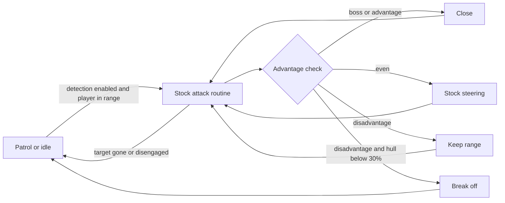
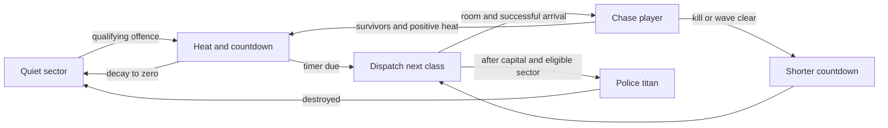
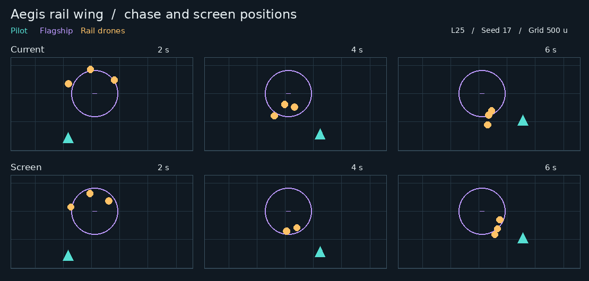
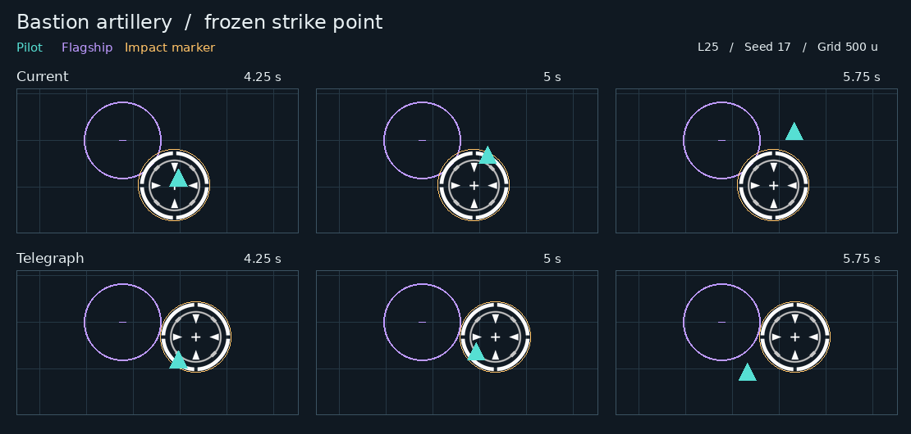

# Enemy AI prototype

Four behaviors are available for owner testing behind independent compile-time switches in `ModTitanAI`. All four default to `false`. The strongest pressure with a visible player response came from putting rail drones between the player and the carrier. At L40, screening intercepted 2,906 pilot salvos in 1,000 seeded carrier finishes, up from 789. Player wins fell from 35.7% to 27.7% and mean encounter duration increased by 0.37 s. These figures measure the arena pilot. Human enjoyment and on-device handling remain **SUSPECTED**. **CONFIRMED** switch defaults and game entry points: `ModTitanAI.java:36`, `ModAegisDrones.java:68`, `ModFleet.java:237`, `ModPolice.java:460`, `ModTitanAI.java:374`. [Experiment results](summary.csv)

## Current behavior map

Each row below is a state diagram for one class or role. Arrows denote transitions, including independent weapon or skill clocks that run alongside navigation. **CONFIRMED** means the cited implementation was followed or executed. **SUSPECTED** marks an inference about gameplay. Java filenames resolve under `src/java/fr/testudo/spacecorsair/mod/`. Enemy smali filenames resolve under `work/smali/fr/testudo/spacecorsair/business/ennemis/`. Line references are for this task branch, based on `a02248c`.

### Fleet and stock combat



**CONFIRMED.** The player physics hook calls the mod tick. The enemy physics hook runs advantage steering after stock AI. The stock attack routine can stop or resume its activity when its target disappears or exceeds disengagement distance. Player-owned drones bypass stock player detection. The advantage layer skips missing, removed, stationary or player-drone actors and fights against non-player targets. Every 500 ms it combines level, class, tier, faction counter and hull fractions. At ≥0.15 it extends pursuit distance and pushes past 220 units. At ≤−0.15 it turns away inside max(300, 80% firing distance), coasts inside firing range, or flees below 30% hull. Bosses always choose the aggressive mode. Sources: `src/patch/hooks.py:40`, `src/patch/hooks.py:49`, `src/patch/hooks35.py:18`, `Ennemis.smali:202`, `Ennemis.smali:247`, `ModV35.java:709`, `ModV35.java:765`, `ModV35.java:787`.

| Role | State transitions followed in source | Evidence |
|---|---|---|
| Fleet spawner | Sector change → clear tracked fleet → wait 30 s → eligible flying player and sector → roll every 24–40 s if ≤15 tracked → pick sector-level faction and 2–4 hulls. Heavier eligible leader, small escorts. At high Kre'tari level, an 8% branch places one mothership. Groups start 3,200 units out and alternate random destinations and 3 s / 2 s waits. | CONFIRMED `ModFleet.java:210`, `ModFleet.java:226`, `ModFleet.java:251`, `ModFleet.java:267`, `ModFleet.java:297` |
| Fighter / Basic | Patrol → face target → thrust with forward-facing target beyond 250 → request fire when raw heading error <5° and inside firing distance → reload. Missile stock, minimum distance and missile timer gate the separate launch request. | CONFIRMED `ModFleet.java:87`, `ModFleet.java:167`, `BasicEnnemyShip.smali:281`, `BasicEnnemyShip.smali:563` |
| Raider / Frelon | Patrol → chase and turn to target → request lasers / missile according to alignment, range and cooldown → chase. Shield is a separate subsystem. | CONFIRMED `ModFleet.java:93`, `FrelonShip.smali:719`, `ModV34.java:415` |
| Gunship / Defensor | Patrol → acquire → update cannon AI → request gun / missile fire and align hull to movement point → repeat. | CONFIRMED `ModFleet.java:99`, `DefensorShip.smali:551` |
| Cruiser / Albatros | Patrol → acquire → update three cannon controllers → request cannon shots / missile → continue engagement. Warlord, dreadnought and Kre'tari heavy rows have explicit class scaling. | CONFIRMED `ModFleet.java:105`, `ModFleet.java:142`, `ModFleet.java:175`, `Albatros.smali:919` |
| Skirmisher / AlienRat | Acquire → choose a random relative approach point → align / move → turn to target and shoot → request teleport on its attack branch → reacquire position. | CONFIRMED `ModFleet.java:114`, `AlienRat.smali:286` |
| Beam ship / UFO | Acquire → update relative target point → range test → start or update beam → resolve beam hit / alterations → continue. | CONFIRMED `ModFleet.java:120`, `UfoAlienShip.smali:243`, `ModV34.java:422` |
| Mothership / AlienBlatte | Solo spawn or mission placement → align → range-gated root shot and beam → spawn child on its population branch → repeat. | CONFIRMED `ModFleet.java:126`, `ModFleet.java:278`, `AlienBlatte.smali:589` |
| Sector patrol / pursuer | Traffic refill → trader quota first → up to four police patrols fly outpost → mine → base → wrecks → disappear. Flagship destruction separately starts persistent play-time pursuit → 2 / 3 / 4 attackers at 10 / 45 / 90 s, last wave with heavy leader → chase player. Kre'tari and Reaver use fleet hulls, other factions use colored police cruisers. | CONFIRMED `ModSector.java:101`, `ModSector.java:373`, `ModSector.java:395`, `ModSector.java:430`, `ModSector.java:441`, `ModSector.java:463` |
| Fixed, rocket and alien turrets / station batteries | Fixed turrets retain stock aim. Station scan → classify player, drones, protected ships, faction, civilians and flagship → pick hostile within activation and range limits → slew mount → aligned and reloaded → fire. Docking, wanted status and faction relations gate the player branch. | CONFIRMED `ModV35.java:782`, `ModStationGuns.java:146`, `ModStationGuns.java:160`, `ModStationGuns.java:197`, `ModStationGuns.java:297`, `ModStationGuns.java:336` |
| Stage-5 Mantis / Verdant | Recognized art → speed-driven wing opening → stop → delayed fold or draw-gap reset. Combat targeting continues through the hull's AI. Stage-5 Hornet separately assigns wing shields and has a Stinger attack. | CONFIRMED `ModWings.java:153`, `ModWings.java:166`, `ModHornet.java:164`, `ModHornet.java:254`, `ModHornet.java:323`, `ModHornet.java:487` |

**CONFIRMED.** Faction projectile processing is another decision layer. On queue commit, identify sender and family → replace or track eligible projectile → update in flight → apply on-hit effects. Spartan rails hold a 0.6 s mark, Reaver flak bursts nearby, Kre'tari spines home and apply acid, Varn ramps damage, Ironclad warns of heavy artillery, Helion trades hull damage for shield damage, and Warden interrupts regen and can jump to a drone. Flagship flak and lance have explicit registrations. The sector owner supplies police weapons, with the unowned-sector fallback. Sources: `src/patch/hooks47_policeguns.py:9`, `ModEnemyGuns.java:19`, `ModEnemyGuns.java:63`, `ModEnemyGuns.java:115`, `ModEnemyGuns.java:199`, `ModEnemyGuns.java:339`, `ModCapitals.java:533`, `ModPolice.java:162`, `ModPolice.java:354`.

### Police escalation



| Class / controller | Transitions and guards | Evidence |
|---|---|---|
| Heat and dispatcher | Safe/multiplayer sector excluded → qualifying civilian rebellion / damage / kill or police hit / kill adds heat → first wave immediately. Hits have per-civilian or global police debounces. While engaged, decay is suppressed, local patrols can join every 2 s, kills shorten the countdown, and a cleared wave brings it down to 8 s. Leave → halve heat → return within ten minutes can restore it. Defend-zone calm suppresses dispatch and joining. | CONFIRMED `ModPolice.java:82`, `ModPolice.java:128`, `ModPolice.java:148`, `ModPolice.java:235`, `ModPolice.java:274`, `ModPolice.java:295`, `ModPolice.java:443`, `ModPolice.java:495`, `ModCalm.java:18` |
| Arrival / composition | Positive heat → next successful wave climbs one class → dispatch two top hulls and lower escort(s), frigate pair, capital group or lone titan. Spartan capital wave has its own composition. Respect eight active ships → nearest eligible gate or ambush → double speed until 2,000 → chase. Failed spawn does not promote the wave. Police use elite hulls, sector-owner weapons and armor. | CONFIRMED `ModPolice.java:89`, `ModPolice.java:98`, `ModPolice.java:106`, `ModPolice.java:329`, `ModPolice.java:576`, `ModPolice.java:620`, `ModPolice.java:631`, `ModPolice.java:669`, `ModPoliceData.java:82` |
| Frigate / Destroyer | Frigate chase → missile ready and within 2,400 → launch → 5 s reload, otherwise retry range. Destroyer hit → snare unless on its per-ship cooldown. | CONFIRMED `ModPolice.java:401`, `ModPolice.java:432` |
| Cruiser / Battlecruiser | Chase → hit shield → additional drain and regen pause → repeat. | CONFIRMED `ModPolice.java:401`, `ModPolice.java:421` |
| Battleship / Capital | Chase → alternate pin and drain hits → in-range missile every 8 s. The shield wall can stop police technology. | CONFIRMED `ModPolice.java:388`, `ModPolice.java:408`, `ModPolice.java:432` |
| Police titan / High Council | After capital, sector top ≥16 and no active titan → faction titan at capped max(sector top, pilot+2) → reacquire player if lost → faction kit, rail wing, lockdown (within 5,000), charge shield breaker (within 4,500) → drain 60% current shield. Overshield absorbs first and refills after a quiet interval. Death clears heat, sector exit / stand-down releases lockdown. Council changes livery. | CONFIRMED `ModPoliceTitan.java:26`, `ModPoliceTitan.java:65`, `ModPoliceTitan.java:123`, `ModPoliceTitan.java:156`, `ModPoliceTitan.java:170`, `ModPoliceTitan.java:224`, `ModPoliceTitan.java:282`, `ModCapitals.java:487` |

**CONFIRMED.** The class fallback in police data picks the nearest stocked hull class. Police generation, edge masks and aura activation depend on art, faction, stage and visibility. They supply appearance rather than dispatch decisions. Sources: `ModPoliceData.java:82`, `ModPoliceGen.java:71`, `ModPoliceGen.java:108`, `ModPoliceEdges.java:66`, `ModPoliceAura.java:37`, `ModPoliceAura.java:159`.

### Flagships, rail wing and cleanup

**CONFIRMED.** Sector entry → find matching HQ → check three-hour respawn → guardian patrol around anchor. Mission setup can create a missing flagship and apply a one-time hull cut. Provocation, nearby civilian attacks, ranking and mission gates can make it hostile. While hostile each mount independently leads, slews, checks its range, reload and 8° alignment, then fires. Skills run inside 6,000 units, with one enrage event below 30% hull. Loss of hostility or range calms active effects. A real kill triggers faction bookkeeping, pursuit and respawn timing. Sources: `ModCapitals.java:115`, `ModCapitals.java:220`, `ModCapitals.java:264`, `ModCapitals.java:284`, `ModCapitals.java:476`, `ModCapitals.java:572`, `ModCapitals.java:588`, `ModLive.java:125`, `ModRep.java:241`, `ModFaction.java:1131`, `ModTitanAI.java:250`, `ModTitanAI.java:275`.

| Flagship / role | Combat state diagram | Evidence |
|---|---|---|
| Spartan Aegis | Incoming front arc → wall absorbs 90% → continue rails. Hostile → launch rail drones. Enrage → mark and protect nearby civilian allies → 12 s → restore previous invincibility. | CONFIRMED `ModTitanAI.java:279`, `ModTitanAI.java:448`, `ModTitanAI.java:132`, `ModCapitals.java:487` |
| Reaver Bloodforge | Close within 2,300 → harpoon drag 2 s. Within 2,600 or enrage → 2.6 s ram → one proximity hit. Enraged → lay bounded trail → proximity burn. | CONFIRMED `ModTitanAI.java:295`, `ModTitanAI.java:301`, `ModTitanAI.java:314` |
| Kre'tari Brood-Mother | Within 3,000 → hive pulse → radar scramble 4 s. Enrage → four decoys around pilot → copy pilot motion 8 s → warp out. | CONFIRMED `ModTitanAI.java:222`, `ModTitanAI.java:327`, `ModTitanAI.java:334`, `ModTitanAI.java:346` |
| Varn Syndicate Crown | Within 2,600 → lay three mines. Within 3,000 → cloak 4 s → incoming damage halved → reveal. Enrage → mine ring and 5 s thrust burst → restore thrust. | CONFIRMED `ModTitanAI.java:349`, `ModTitanAI.java:358`, `ModTitanAI.java:363`, `ModTitanAI.java:471` |
| Ironclad Bastion | Hit → first intact plate soaks 70% until broken. Within 3,800 and artillery ready → lock pilot position → 2 s marked radius → impact once if still within 380 → cooldown. Enrage → regrow plates once. | CONFIRMED `ModTitanAI.java:372`, `ModTitanAI.java:379`, `ModTitanAI.java:457`, `ModTitanAI.java:515` |
| Helion Sunspire | Within 3,000 → sweep a lance for 3 s → damage inside angular and range gate. Within 3,500 → 0.9 s lateral closing dash. Enrage → expanding supernova → one ring contact. | CONFIRMED `ModTitanAI.java:385`, `ModTitanAI.java:398`, `ModTitanAI.java:406` |
| Warden | Within 2,600 → tractor 3 s. Within 3,000 → disrupt boost 4 s. Within 4,200 → freeze rail segment → aim 1.2 s → resolve against segment. Enrage → lock boost and missiles 6 s. | CONFIRMED `ModTitanAI.java:414`, `ModTitanAI.java:420`, `ModTitanAI.java:425`, `ModTitanAI.java:431` |
| Aegis rail fighter | Hostile Spartan flagship or any police titan → launch after 1.5 s → roll 2–5 → chase pilot with stock blaster silenced → independent led rail each 2.2 s while within 3,200. Missing wing members start a 10 s refill clock. Calm, dead carrier or sector change → drop wing. | CONFIRMED `ModCapitals.java:487`, `ModAegisDrones.java:27`, `ModAegisDrones.java:47`, `ModAegisDrones.java:84`, `ModAegisDrones.java:109`, `ModAegisDrones.java:140` |
| Warping decoy / brood | Start once → zero bullet damage, delay next shot, make invincible → fade drawn entries → after 3 wall-clock seconds restore vulnerability and remove → clear on sector change. | CONFIRMED `ModWarpOut.java:26`, `ModWarpOut.java:54`, `ModWarpOut.java:75`, `ModWarpOut.java:83`, `ModCaps.java:143`, `ModLive.java:99` |

### Mission bosses and other combat entry points

| Role | Combat state diagram | Evidence |
|---|---|---|
| Matriarch | Enter objective sector → spawn UFO → approach within 2,500 → attack. Blink near target inside 3,000, create gravity well inside 2,600, pull while active. Below 35% → spawn two harmless one-hull illusions and accelerate blink. | CONFIRMED `ModBoss.java:258`, `ModBoss.java:373`, `ModBoss.java:388`, `ModBoss.java:413`, `ModBoss.java:424` |
| Rogue Cruiser | Engage → first crossings below 66% and 33% → shield for 6 s plus two Defensors → shield down. Close shockwave repeats; aim 1.5 s inside 2,200 → broadside. Below 30% → 10 s overdrive → restore reload. | CONFIRMED `ModBoss.java:263`, `ModBoss.java:438`, `ModBoss.java:450`, `ModBoss.java:459`, `ModBoss.java:468`, `ModBoss.java:477` |
| Hive Empress | Engage → spawn three brood periodically → heal per living brood → three rooting shots inside 2,200 and periodic proximity venom. Below 30% → create following spore cloud → drain shield while inside → cloud expires. Mission kill pays once and removes illusions. Give-up removes boss and warps surviving illusions and brood. | CONFIRMED `ModBoss.java:258`, `ModBoss.java:490`, `ModBoss.java:500`, `ModBoss.java:504`, `ModBoss.java:518`, `ModBoss.java:527`, `ModBoss.java:626`, `ModBoss.java:747` |
| Contract guards / raiders | Set objective → post guards or spawn targeted reinforcements. Pickup proximity or halfway progress → ambush. Convoy contact → waves split between pilot and civilian. Zone defense → allocate attackers to outpost and pilot. Bounty escape → clean up and rebuild. Kill quota → replenish. Escort route progress → two ambushes. Scan near completion → attack. Flagship mission → provoke inside 4,500. | CONFIRMED `ModFaction.java:626`, `ModFaction.java:658`, `ModFaction.java:692`, `ModFaction.java:822`, `ModFaction.java:955`, `ModFaction.java:1005`, `ModFaction.java:1025`, `ModFaction.java:1054`, `ModFaction.java:1068`, `ModFaction.java:1093`, `ModFaction.java:1124` |
| Prologue Bloodforge | Scripted encounter → hold boss above hull floor → pilot damage / clock triggers ending → resolve scripted death. Prologue owns its sector and bypasses ordinary flagship kill bookkeeping. | CONFIRMED `ModPrologue.java:54`, `ModPrologue.java:140`, `ModPrologue.java:153`, `ModPrologue.java:291`, `ModPrologue.java:306`, `ModCapitals.java:116`, `ModCapitals.java:588` |

**CONFIRMED.** The inspected hook files assign ownership of the decisions above. Hooks 14 and 30 route Guardian geometry/drawing and damage to Java. Hooks 34 and 35 handle stock-level construction and post-stock steering. Hooks 42a/42b and 47 route player target selection, credit for police kills and queued police projectiles. Hooks 49b exclude the co-op stand-in from encounter counts. **SUSPECTED.** Frame ordering across actors, render visibility, Android input and timing around sector changes can change who gets a shot or collision first on a device. Sources: `src/patch/hooks14.py:1`, `src/patch/hooks30.py:52`, `src/patch/hooks34.py:29`, `src/patch/hooks35.py:18`, `src/patch/hooks42a.py:22`, `src/patch/hooks42b.py:1`, `src/patch/hooks47_policeguns.py:9`, `src/patch/hooks49b_lan_count.py:15`.

## Headless arena and baseline

The arena advances by 50 ms in two dimensions. A ship moves by velocity × elapsed milliseconds / 10. Rail and battery lead use that same unit. Shots travel through space; a relative swept segment intersects the earliest opposing hull circle, so a screen can intercept a shot aimed at the carrier. Each seed supplies an entry position, surviving hull, orbit size, reaction delay, roster and separate per-shooter aim sequence. Both arms use the same scenario and seed. **CONFIRMED** game-unit conversion, battery gates and arena integration: `ModCapitals.java:78`, `ModCapitals.java:499`, `ModAegisDrones.java:149`, `Arena.java:211`, `Arena.java:363`, `Arena.java:369`.

| Input | How the arena uses it |
|---|---|
| Pilot and gear | L10 Bastion, L25 Raptor, L40 Monolith. Look up the actual hull, base life by level, life multiplier, cannon count, reload, damage modifier, thrust and drag. Select the highest unlocked rail tier. The pilot tracks a nearby target, orbits and reacts to the same visible artillery marker in both arms. **CONFIRMED** `ModShips.java:80`, `ModShips.java:97`, `ModShips.java:149`, `ModShips.java:450`, `ModV34.java:37`, `ModWeapons.java:37`, `ModSpecs.java:18`, `Arena.java:94`, `Arena.java:227`. |
| Patrol | 2–4 light hulls from the two BASIC fleet rows. Read the stock fighter damage / reload / turn row, mod base hull, class factors, level curve and seeded tech tier. The arena assigns the seven faction keys across seeds for the personality comparison. A light allied wingman gives focus fire two potential targets. **CONFIRMED** `ModFleet.java:48`, `ModV34.java:304`, `ModV34.java:355`, `ModV34.java:380`, `ModFactionData.java:7`, `Arena.java:119`, `Arena.java:291`. |
| Police | Start partway through an incident, at one of the first three escalation tiers. Sector-owner battery family, class hull/weapon multipliers, elite factors, class composition, cap, kill-cut and floor feed the encounter. Clearing the current field counts as winning this encounter. **CONFIRMED** `ModPolice.java:98`, `ModPolice.java:106`, `ModPolice.java:208`, `ModPolice.java:669`, `ModV34.java:607`, `Arena.java:119`, `Arena.java:265`. |
| Capital finish | Spartan carrier for the escort tests, Ironclad for artillery. Use the faction hull multiplier, one surviving faction mount, actual gun range, speed, spread, damage multiplier and reload, plus the actual drone hull share and respawn roll. Start with shields exhausted and 1–32 pilot salvos of hull remaining. The objective is to finish the carrier, so a drone hit can cost the pilot a firing opportunity. **CONFIRMED** `ModCapitals.java:52`, `ModCapitals.java:90`, `ModCapitals.java:240`, `ModAegisDrones.java:27`, `Arena.java:53`, `Arena.java:244`. |

**CONFIRMED baseline check.** In the reference fight, the closed `BasicEnnemyShip.doAttackIa` bytecode decides whether to thrust and request a shot every tick. In the arena fight, the independently implemented distance and angle predicates decide. Both use the same seeded encounter, advantage policy, physics and gunnery. All 306 steps matched for ship positions, surviving hull, fire/thrust requests and shots in flight. An independent matrix tests 42 input pairs on both sides of the firing and thrust boundaries. Sources: `BasicEnnemyShip.smali:281`, `ModV35.java:765`, `Experiment.java:31`, `Experiment.java:74`, `Arena.java:187`. [Boundary probes](baseline.csv) · [Side-by-side fight trace](baseline-fight.csv)

| L25 patrol, seed 17 | Live hostiles, JAR / arena | Pilot HP, JAR / arena | Shots in flight, JAR / arena |
|---|---:|---:|---:|
| 0.50 s | 4 / 4 | 21,509.5 / 21,509.5 | 3 / 3 |
| 5.50 s | 3 / 3 | 21,385.8 / 21,385.8 | 8 / 8 |
| 7.50 s | 2 / 2 | 20,330.1 / 20,330.1 | 4 / 4 |
| 15.30 s | 0 / 0 | 20,330.1 / 20,330.1 | 1 / 1 |

**SUSPECTED transfer to the game.** Fixed-step turning and damping, circular hitboxes, the strafe-and-dodge pilot, consolidated player salvos, and a center-firing capital mount are approximations. The simulation omits shield recharge, missiles, most signature effects and the remainder of the capital kit. It uses BASIC steering for the police wave comparison and a stock fighter row as the capital's base-shot proxy. The live police classes, Guardian batteries, long-hull collision shape and shield pipeline are broader. Calibrated end-of-fight snapshots make the two flagship mechanics observable across levels; their win rates describe those snapshots. Full-device parity and human play feel are unmeasured. Sources: `ModPoliceData.java:28`, `ModCapitals.java:249`, `ModCapitals.java:349`, `ModCapitals.java:476`, `ModV34.java:502`, `Arena.java:53`, `Arena.java:119`, `Arena.java:227`.

## Paired experiment

Seeds 0–999 are reused across each control and treatment. There are 1,000 pairs per rule per hull, 24,000 pairs overall. Each treatment enables one switch. Win rate uses all starts. TTK is mean seconds to destroy the objective **among pilot wins**. HP lost measures actual pilot hull depleted, capped at the pilot's hull on entry, across all outcomes. A patrol escape ends without a kill. Timeouts are fights still running at 90 s. Mean encounter duration, activation counts and hit counts are in the summary; the compressed CSV records each run and its terminal outcome. [Aggregate data](summary.csv) · [48,000 fight records](fights.csv.gz)

| Behavior | Level | Win %, current → on | Win TTK s, current → on | Mean HP lost, current → on | Timeouts, current → on |
|---|---:|---:|---:|---:|---:|
| Focus fire | 10 | 68.7 → 83.1 | 16.38 → 16.28 | 171.6 → 59.4 | 0 → 0 |
| Focus fire | 25 | 97.8 → 98.2 | 9.04 → 8.86 | 577.9 → 192.7 | 0 → 0 |
| Focus fire | 40 | 25.6 → 40.6 | 37.01 → 32.55 | 35,536.2 → 10,508.7 | 276 → 189 |
| Flank / encircle | 10 | 7.9 → 7.9 | 1.44 → 1.47 | 754.0 → 754.7 | 0 → 0 |
| Flank / encircle | 25 | 16.3 → 16.3 | 3.50 → 3.60 | 13,837.4 → 13,877.9 | 0 → 0 |
| Flank / encircle | 40 | 35.7 → 37.5 | 8.43 → 8.29 | 89,511.1 → 88,227.8 | 0 → 0 |
| Range band | 10 | 68.7 → 90.8 | 16.38 → 13.26 | 171.6 → 187.9 | 0 → 0 |
| Range band | 25 | 97.8 → 99.9 | 9.04 → 7.50 | 577.9 → 607.7 | 0 → 0 |
| Range band | 40 | 25.6 → 88.8 | 37.01 → 29.73 | 35,536.2 → 35,103.0 | 276 → 0 |
| Retreat / repair | 10 | 68.7 → 70.7 | 16.38 → 18.66 | 171.6 → 171.6 | 0 → 0 |
| Retreat / repair | 25 | 97.8 → 96.4 | 9.04 → 9.62 | 577.9 → 569.0 | 0 → 0 |
| Retreat / repair | 40 | 25.6 → 32.9 | 37.01 → 39.95 | 35,536.2 → 37,375.9 | 276 → 139 |
| Capital screen | 10 | 7.9 → 7.5 | 1.44 → 1.40 | 754.0 → 756.5 | 0 → 0 |
| Capital screen | 25 | 16.3 → 15.2 | 3.50 → 3.37 | 13,837.4 → 13,935.7 | 0 → 0 |
| Capital screen | 40 | 35.7 → 27.7 | 8.43 → 7.42 | 89,511.1 → 93,141.1 | 0 → 0 |
| Police distress | 10 | 4.2 → 1.8 | 27.62 → 25.51 | 677.2 → 692.5 | 163 → 160 |
| Police distress | 25 | 32.9 → 25.7 | 17.23 → 14.87 | 10,102.6 → 10,909.1 | 133 → 110 |
| Police distress | 40 | 0.0 → 0.0 | — → — | 118,012.6 → 118,146.1 | 28 → 23 |
| Predictive artillery | 10 | 25.6 → 25.2 | 6.73 → 6.71 | 628.6 → 630.4 | 0 → 0 |
| Predictive artillery | 25 | 57.4 → 58.5 | 12.05 → 12.23 | 9,945.2 → 9,865.1 | 0 → 0 |
| Predictive artillery | 40 | 81.5 → 76.5 | 16.98 → 16.40 | 52,389.2 → 57,504.6 | 0 → 0 |
| Faction personalities | 10 | 68.7 → 91.2 | 16.38 → 13.05 | 171.6 → 175.3 | 0 → 0 |
| Faction personalities | 25 | 97.8 → 100.0 | 9.04 → 7.42 | 577.9 → 531.8 | 0 → 0 |
| Faction personalities | 40 | 25.6 → 89.1 | 37.01 → 29.64 | 35,536.2 → 30,505.9 | 276 → 0 |

A dash means no pilot won in that arm. Comparing TTK alone can be misleading when the winning seeds change, especially in the police encounters.

### Selection for the game port

| Switch | What the player can do | What the runs showed |
|---|---|---|
| `ModTitanAI.AI2_SCREEN` | A hostile carrier's rail wing takes slots across the approach line. Move sideways to open a lane or shoot the screening drone. Outside rail range, the wing returns to stock pursuit. | **CONFIRMED in the arena.** At L40, more interceptions, eight percentage points fewer wins and similar encounter length. **SUSPECTED on device.** The lanes may reward repositioning. `ModTitanAI.java:43`, `ModAegisDrones.java:68`. |
| `ModTitanAI.AI2_PREDICT_ARTILLERY` | The Bastion places its warning up to one second ahead of the moving pilot, capped at 760 units. Change direction after the lock. Marker and impact use the same frozen point throughout the two-second fuse. | **CONFIRMED in the arena.** L40 hits rose from 336 to 619, pilot wins fell five points and fights ended 0.50 s sooner on average. L25 pilot wins rose 1.1 points. **SUSPECTED on device.** The lock gives the player time to countersteer. `ModTitanAI.java:72`, `ModTitanAI.java:374`, `ModTitanAI.java:515`. |
| `ModTitanAI.AI2_RADIO` | A surviving police hull below 60% can shorten the countdown once per escalation tier. Finishing it in one pass avoids the call. Tier delays respect the eight-second floor and existing dispatch, field cap, calm and sector checks. | **CONFIRMED in the arena.** At L25 wins fell 7.2 points while mean encounter time fell from 37.92 to 31.75 s. L40 produced zero pilot wins in either arm. **SUSPECTED on device.** A wounded ship's call may reward target prioritization. `ModPolice.java:219`, `ModPolice.java:460`, `ModPolice.java:576`. |
| `ModTitanAI.AI2_KITE` | BASIC fighters tracked by the faction-fleet spawner steer toward 58–84% of their own firing range while targeting the pilot. They close outside the band, back off inside it and brake within it. | **CONFIRMED in the arena.** At L40 the rule resolved all 276 baseline timeouts and raised player wins from 25.6% to 88.8%. This is a pacing option. At L10 it also increased mean damage received by 16.3 HP. **SUSPECTED on device.** Keeping an opponent within reach may make target reacquisition less tedious. `ModFleet.java:237`, `ModTitanAI.java:54`, `ModTitanAI.java:63`. |

**Arena-only switches.** Focus fire chooses the weakest living eligible pilot-side hull by absolute HP. The allied wingman often drew the fire, so L40 player HP lost fell from 35,536 to 10,509. Flankers take evenly spaced bearings around the pilot; L40 interceptions fell from 789 to 378 and player wins rose. Retreat/repair breaks off below 25%, suspends fire, and repairs once beyond 800 units until 45%. It added about three seconds to L40 winning fights. Faction personalities use the seven data keys. Reavers close, Kre'tari take swarm slots, Wardens hold an outer band, Varn stand off, Spartans hold formation distance, Ironclads hold middle range, and Helion closes to a shorter band. The numeric bands are design choices in the tool. The pooled result mostly reproduced the pacing benefit of kiting. **CONFIRMED** experiment policies and data keys: `Arena.java:283`, `Arena.java:291`, `Arena.java:312`, `Arena.java:346`, `ModFactionData.java:7`. [Per-run outcomes](fights.csv.gz)

### Arena frames

L25, seed 17. The pilot is a teal triangle, the capital a purple circle and the drones amber circles. At 6 s the enabled screen sits on the player-facing side of the carrier. [Replay coordinates](replay-screen.csv)



The artillery snapshots use the shipped Ironclad marker. At 4.25 s the current marker is centered on the pilot's recent position and the enabled marker is ahead. At 5.75 s the pilot has moved and both marks remain locked on their original coordinates. [Replay coordinates](replay-telegraph.csv)



## Reproduction and verification

From the repository root, with the workspace JDK 17 (Java 8 bytecode), Python 3 and Pillow. The first compile uses the repository's prescribed classpath. The headless driver and tests load the newly compiled mod classes first.

```sh
export PATH=/workspace/setup/tools/jdk17/bin:$PATH
export CP=/tmp/mc:work/game_v168.jar:work/stubcls:tools/android-4.1.1.4.jar
mkdir -p /tmp/mc && javac --release 8 -nowarn -cp work/game_v168.jar:tools/android-4.1.1.4.jar:work/stubcls -d /tmp/mc src/java/fr/testudo/spacecorsair/mod/*.java
javac --release 8 -cp "$CP" -d /tmp/mc codex/tools/b2-03/*.java work/dtest/fr/testudo/spacecorsair/mod/B2ArenaAI.java
java -cp "$CP" fr.testudo.spacecorsair.mod.B2ArenaAI
java -Xmx512m -cp "$CP" fr.testudo.spacecorsair.mod.Experiment codex/out/b2-03 1000
python3 codex/tools/b2-03/frames.py codex/out/b2-03
```

```text
Note: Some input files use or override a deprecated API.
Note: Recompile with -Xlint:deprecation for details.
Note: Some input files use unchecked or unsafe operations.
Note: Recompile with -Xlint:unchecked for details.
B2 AI OK (31 checks)
L25 patrol seed 17 matched for 306 steps (win).
42 baseline probes matched; 24000 paired fights (48000 runs).
Rendered screen.png and telegraph.png
```

The driver also accepts `replay SCENE LEVEL SEED [RULE ...]` and writes CSV to stdout. Scenes are `PATROL`, `AEGIS`, `POLICE`, and `BASTION`. Omit all rules for a baseline or supply one or more names from the results CSV. The four game switches are compile-time constants. Validation covered the JVM and the headless arena. Android playtesting remains outstanding.


A second full run and both rendered figures compared byte-for-byte with the checked-in evidence. The following checks ran from the same shell:

```sh
set -e -o pipefail
java -Xmx512m -cp "$CP" fr.testudo.spacecorsair.mod.Experiment /tmp/b2-03-repeat 1000
python3 codex/tools/b2-03/frames.py /tmp/b2-03-repeat
for f in /tmp/b2-03-repeat/*; do cmp "$f" "codex/out/b2-03/${f##*/}"; done
java -cp "$CP" fr.testudo.spacecorsair.mod.Experiment replay AEGIS 25 17 SCREEN | wc -l
(cd server/rendezvous && node test/registry.test.mjs) | tail -1
```

```text
L25 patrol seed 17 matched for 306 steps (win).
42 baseline probes matched; 24000 paired fights (48000 runs).
Rendered screen.png and telegraph.png
125
REGISTRY OK
```
