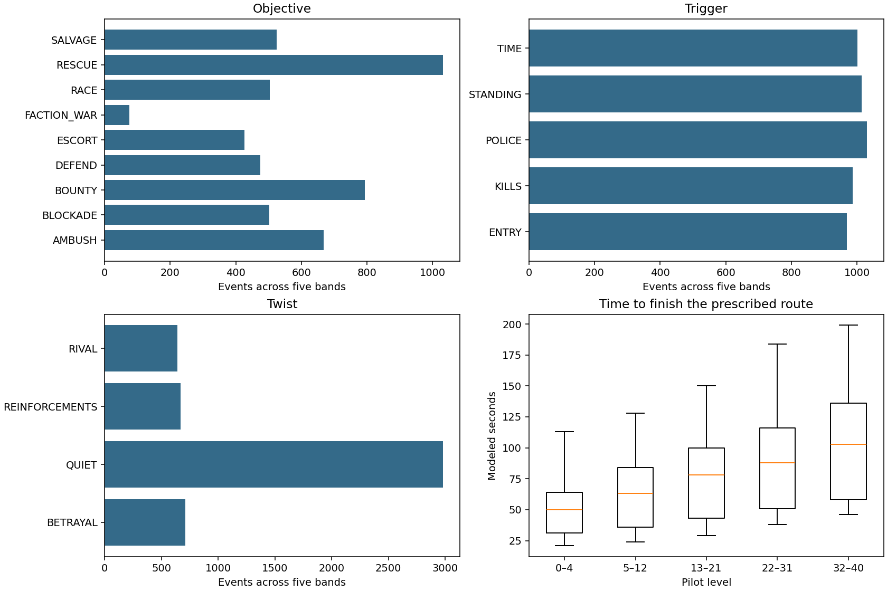

# TASK-04 · Procedural sector events

**CONFIRMED.** The generator produced 5,000 events from 5,000 distinct seeds. All nine objectives appeared. Every manifest had a reachable completion path under the pilot model, referenced shipped assets, and fit the simulator’s three-bounty mission allowance. Mean modeled completion time rose from 50.16 seconds at levels 0–4 to 102.15 at levels 32–40. The largest appraised reward was 2.973 same-level simulator bounties. [Distribution tables](distributions.md) · [50 complete events](samples.jsonl) · [Mission, POI and reward inventory](inventory.md)



**CONFIRMED.** The inventory traces all 38 stock mission factories, including the Ventohigh placeholder, 21 faction story missions, three Hive finales, 56 regular/amends contracts, seven renegade hunts, both Lance offers, the three boss offers, and 12 derelict sites. It maps sector placements, encounters, settlement and repeat rewards to their inputs and outputs. The main inventory traces the requested branch at `a02248c`. Its final section inventories the live events added on the PR target. Prototype and validation citations below refer to this revision. See `business/mission/MissionRepository.smali:113` under the smali root and `ModFaction.java:88`, `ModBoss.java:89`, `ModV30Data.java:32` under the mod Java root. [Inventory](inventory.md)

## Generation rules

**CONFIRMED.** The caller supplies the event edge, seed, pilot level, issuing faction, sector owner, standing with the issuer, elapsed seconds, kill count, heat and actual police wave class. Entry is immediately eligible. A time edge requires 60 seconds, a standing edge requires +20, a kill edge requires three kills, and a police edge requires positive heat and an observed wave class. An early edge returns no offer. The caller owns edge detection, so remaining above a threshold does not itself schedule a stream of missions. See `ModEvents.java:372`, `ModEvents.java:393`, `ModEvents.java:449`, `ModPolice.java:98`.

**CONFIRMED.** The generator selects uniformly among eligible objective rows, then expands the selected row into ordered contacts. A seeded permutation of the input bits precedes Java’s pseudorandom draws so consecutive integer seeds sample the objective table. The catalog specifies actors, objective actions, text and eligible triggers. The relation check uses the existing seven-faction matrix. See `ModEvents.java:341`, `ModEvents.java:363`, `ModEvents.java:442`, `ModRep.java:36`.

| Objective | Additional eligibility | Completion path |
|---|---|---|
| Escort | Standing above −10 | Meet the hauler, clear its attackers and accompany it to the dock. |
| Defend | Standing above −10 | Rendezvous at the outpost, clear attackers and hold it through repairs. |
| Ambush | Entry or kill edge | Clear the incoming pirate flight. |
| Salvage | Entry or timer | Open the marked wrecks. |
| Bounty | Kill or standing edge | Destroy one marked cutter. |
| Blockade run | Active police wave | Pass the patrol and reach the exit beacon. Wave class sets patrol count. |
| Faction war | Level 22+, Friendly standing, hostile relation between issuer and owner | Defeat the sector owner’s wing before the deadline. |
| Rescue | Entry, timer or police edge | Extract the marked crews and deliver them to a dock. |
| Timed race | Entry or timer | Visit three ordered station beacons before the clock expires. |

**CONFIRMED.** The table follows `ModEvents.java:341`, `ModEvents.java:363` and `ModEvents.java:460`. Betrayal introduces a guide that later turns hostile. Reinforcements add a separate pirate flight. A rival corsair appears at the start and imposes a deadline. Straightforward bounty, ambush and salvage events use a quiet route. Each stop records actor, art, count, required interactions, distance from entry and hold duration. Shipped assets include the Tortoise hauler, Hornet wreck, outpost, stock police cruiser, Reaver hulls and Kre’tari scout. Sources include `ModEvents.java:405`, `ModEvents.java:456`, `ModEvents.java:478`, `ModEvents.java:514`, `ModFleet.java:47`, `ModShips.java:113`, `ModPoi.java:63`, `ModV30Data.java:45`.

**CONFIRMED.** Gameplay copy consists of nine short objective briefings and three twist lines. Each literal carries a searchable `B2_04_EN` key for the owner’s Spanish pass. The templates follow the imperative style of the existing contract instructions. See `ModEvents.java:333`, `ModEvents.java:341`, `ModFaction.java:147`, `ModRepData.java:39`.

## Economy and solvability

**CONFIRMED.** The credit budget starts at two to three integer game bounties at the pilot’s level. A salvage or rescue manifest includes one piece of malachite (Fine) or one diamond (Rare, level 10+). Its maximum catalog price comes out of the cash. A parts reward reserves one game bounty for a single refit part. The standing change goes to the issuer and respects the +100 cap. The audit independently reads both commodity rarities and maximum prices from the item definitions and reads the fitted bounty and mission coefficients from the economy simulator’s output. Kill bounties and ambient random drops belong to the simulator’s separate kill and loot income streams. See `ModEvents.java:494`, `ModV34.java:277`, `ModV35.java:150`, `ModRep.java:127`, `tools/sim/econ_sim.py:39`, `work/smali/fr/testudo/spacecorsair/business/loot/SpaceObjectType.smali:919` and `work/smali/fr/testudo/spacecorsair/business/loot/SpaceObjectType.smali:952`, and `codex/tools/b2-04/validate.py:65`.

**Model choices.** The simulator fitted 360 × (level + 1)^1.2, while the game uses 355.5 × (level + 1)^1.2. Generation uses the lower curve. Appraisal uses full maximum commodity price and reserves one simulator bounty per part. That reservation is a prototype valuation for a refit resource. Standing has no cash component. Solvability uses an unobstructed local route, 50 distance units per second, 10 seconds per matched-level combat target and four seconds per other contact, plus stated hold time. The route walker verifies compatible actors, sufficient available targets, protected contacts, cargo hand-in, ordered gates and deadlines. It checks every generated event and rejects a non-increasing mean workload across bands. See `ModEvents.java:491`, `ModEvents.java:494`, `ModV34.java:277`, `tools/sim/econ_sim.py:39`, `codex/tools/b2-04/validate.py:26`, `codex/tools/b2-04/validate.py:117`.

**CONFIRMED.** The five bands are prototype sampling bins. The sweep uses 1,000 consecutive seeds per bin and a separate seeded context stream conditioned on a qualifying edge. Every level 0–40 is represented. Faction war first appears in the 22–31 bin because of its level and rival-faction requirements. Samples take ten complete manifests per bin, first covering distinct available objectives and then filling in seed order. Replay any line by passing its seed and context to the CLI. See `codex/tools/b2-04/EventTool.java:8`, `codex/tools/b2-04/EventTool.java:36`, `codex/tools/b2-04/validate.py:117`. [Counts and reward ratios](distributions.md)

## Game hook

**CONFIRMED.** `ModEvents.onTrigger` is a callable game-thread prototype. Its first operation checks `ModEvents.ENABLED`, which defaults to false. Once enabled and called, it reads the live pilot, map owner, standing and heat. Bounty builds a marked Reaver cutter, ambush builds a flight and assigns the pilot as its attack target, and salvage places marked split wrecks with a shared stock loot roll. The existing factories place actors, and commander comms displays the generated brief after a successful spawn. The supported paths decline an active mission, prologue, co-op, excluded sector, map view or docked pilot. See `ModEvents.java:326`, `ModEvents.java:528`, `ModEvents.java:543`, `ModFleet.java:163`, `ModSector.java:339`, `ModFaction.java:658`, `ModLoot.java:232`, `ModComms.java:94`.

**CONFIRMED.** The requested branch predates the PR target’s existing event scheduler. On the rebased target, the normal event slot tries the new hook when enabled, using a qualifying kill chain or elapsed sector time. Other manifests fall through to the existing distress, bounty and salvage-race selection. External game-thread callers may supply the other trigger edges. See `ModEvents.java:55`, `ModEvents.java:70`, `ModEvents.java:127`, `ModChain.java:28`.

**SUSPECTED on device.** Asset readiness, combat survival, obstruction, steering and real elapsed times depend on the live game and pilot loadout. Verification covered compilation, data and JVM behavior. The three adapters cover spawning. Tracking completion and paying a generated manifest would require future game integration. See `ModEvents.java:528`, `ModEvents.java:543`, `ModPlace.java:84`, `ModFleet.java:163`, `ModCaps.java:140`.

## Reproduce

Run from the repository root with a JDK supporting `javac --release 8`, Python 3 and Matplotlib 3.9 or later. The standalone launcher builds in a temporary directory. The following transcript records the verification commands and their output.

```sh
export PATH=/workspace/setup/tools/jdk17/bin:$PATH
mkdir -p /tmp/mc && javac --release 8 -nowarn -cp work/game_v168.jar:tools/android-4.1.1.4.jar:work/stubcls -d /tmp/mc src/java/fr/testudo/spacecorsair/mod/*.java
# Note: Some input files use or override a deprecated API.
# Note: Recompile with -Xlint:deprecation for details.
# Note: Some input files use unchecked or unsafe operations.
# Note: Recompile with -Xlint:unchecked for details.

CP=/tmp/mc:work/game_v168.jar:tools/android-4.1.1.4.jar:work/stubcls
javac --release 8 -cp "$CP" -d /tmp/mc codex/tools/b2-04/EventTool.java work/dtest/fr/testudo/spacecorsair/mod/ProcgenEventsTest.java
java -cp "$CP" fr.testudo.spacecorsair.mod.ProcgenEventsTest
# PROCGEN OK: thresholds, disabled hook, 5000 deterministic replays, 9 objectives, 4 twists

python3 tools/sim/econ_sim.py /tmp/b2-04-economy.md
# wrote /tmp/b2-04-economy.md
# {'kb': 20.0, 'bp': 1.2, 'loot': 0.5, 'mf': 3.0}

java -cp "$CP" fr.testudo.spacecorsair.mod.EventTool sweep >/tmp/b2-04-events.jsonl
wc -l /tmp/b2-04-events.jsonl
# 5000 /tmp/b2-04-events.jsonl
XDG_CACHE_HOME=/tmp/b2-04-cache MPLCONFIGDIR=/tmp/b2-04-mpl python3 codex/tools/b2-04/validate.py /tmp/b2-04-events.jsonl /tmp/b2-04-economy.md
# AUDIT OK: 1000 distinct seeds in each of 5 bands, levels 0-40, 5000 routes and reward budgets
# Wrote 50 full samples, distribution tables and charts
(cd server/rendezvous && node test/registry.test.mjs > /tmp/b2-04-registry.log && tail -1 /tmp/b2-04-registry.log)
# REGISTRY OK
wc -l codex/out/b2-04/samples.jsonl
# 50 codex/out/b2-04/samples.jsonl

codex/tools/b2-04/run.sh 42 20 spartan reaver 40 0 -1 60 3 KILLS
# Note: Some input files use or override a deprecated API.
# Note: Recompile with -Xlint:deprecation for details.
# Note: Some input files use unchecked or unsafe operations.
# Note: Recompile with -Xlint:unchecked for details.
# {"seed":42,"level":20,"faction":"spartan","owner":"reaver","standing":40,"heat":0,"policeTier":-1,"seconds":60,"kills":3,"trigger":"KILLS","objective":"AMBUSH","twist":"QUIET","brief":"Raiders off your bow. Break the ambush.","twistBrief":"","encounterLevel":20,"stops":[{"action":"CLEAR","actor":"RAIDER","art":"rv_gunship","distance":1437,"count":2,"required":2,"holdSeconds":0}],"deadlineSeconds":0,"reward":{"credits":28296,"rareParts":0,"standingFaction":"spartan","standingDelta":1,"item":"","lootTier":""}}
```
